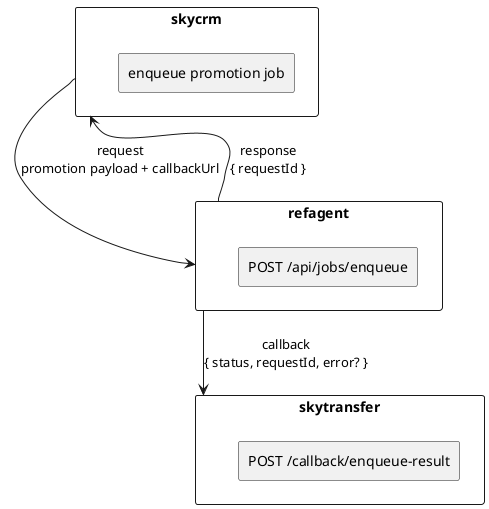
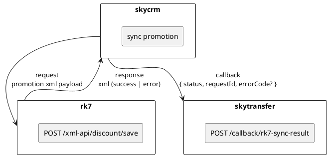

# api contract diagram — promotion sync 

## mục tiêu
- mô tả **hợp đồng api**, không mô tả xử lý nội bộ
- tách rõ **async (queue)** vs **sync (xml api)**
- nhìn sơ đồ là biết: ai gọi ai, dữ liệu gì, kết quả ở đâu
- đủ để dev backend + integration dùng ngay

---

## phạm vi giữ lại (20/80)
- actor (service)
- endpoint
- request / response chính
- callback
- async vs sync

ngoài phạm vi này: **loại**
- logic nghiệp vụ chi tiết
- field không ảnh hưởng contract
- trình bày trang trí

---

## [3.1] async — skycrm ⇄ refagent (enqueue job promotion)

### bản chất contract
- skycrm **enqueue job**
- refagent **nhận job + trả request id**
- xử lý async
- callback kết quả qua skytransfer

---

### plantuml — contract view (chuẩn dùng lâu)



---

### contract tóm tắt

#### request (skycrm → refagent)

* method: post
* endpoint: `/api/jobs/enqueue`
* type: async
* body:

  * actName
  * payload (promotion)
  * callbackUrl

#### response (refagent → skycrm)

* trả **ngay**
* chỉ xác nhận đã enqueue
* không chứa kết quả xử lý

```json
{
  "success": true,
  "data": {
    "requestId": "uuid"
  }
}
```

#### callback (refagent → skytransfer)

* gọi sau khi xử lý xong
* dùng để:

  * báo success / fail
  * correlate bằng requestId

---

### decision rõ ràng

* enqueue fail → skycrm biết ngay
* xử lý fail → **chỉ biết qua callback**
* không callback = job treo / retry

---

## [3.2] sync — skycrm ⇄ rk7 (xml api)

### bản chất contract

* skycrm gọi rk7 **đồng bộ**
* rk7 trả kết quả **ngay**
* skycrm chủ động callback kết quả về skytransfer

---

### plantuml — contract view



---

### contract tóm tắt

#### request (skycrm → rk7)

* method: post
* endpoint: `/xml-api/discount/save`
* type: sync
* format: xml

#### response (rk7 → skycrm)

* trả ngay
* chứa:

  * success
  * error code (nếu có)

#### callback (skycrm → skytransfer)

* luôn được gọi
* phản ánh kết quả sync thực tế

---

## so sánh nhanh async vs sync

* async:

  * không block
  * cần callback
  * cần xử lý retry / timeout
* sync:

  * đơn giản
  * block theo latency rk7
  * lỗi thấy ngay

---

## quy ước dùng lâu (bắt buộc)

* async:

  * response **không** mang business result
  * callback **phải có requestId**
* sync:

  * response quyết định success / fail
  * callback chỉ để notify hệ thống khác
* không trộn async logic vào sync contract

---

## checklist trước khi commit contract

* đã xác định async hay sync?
* ai là caller, ai callback?
* requestId có xuyên suốt?
* callback có đủ status + error?
* sơ đồ chỉ mô tả contract, không mô tả xử lý?

fail 1 mục → **contract chưa rõ**

---

## kết luận

* coi api contract như giao kèo
* rõ vai trò > nhiều field
* sơ đồ dùng để **giảm tranh cãi**, không phải để trang trí