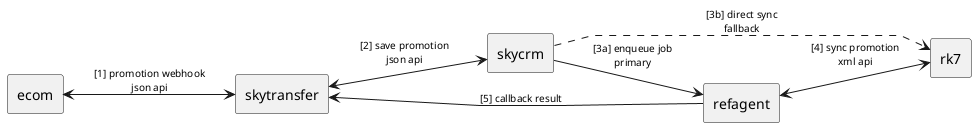
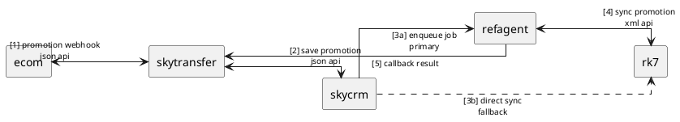

# mục tiêu
- mô tả flow api promotion từ trái → phải
- sơ đồ chỉ phục vụ đọc nhanh & quyết định integration
- label nằm giữa connector, không che component
- xuống dòng bằng "\n"
- không mô tả logic xử lý ngoài routing chính

---

## s1 — polyline (ưu tiên, dễ căn label)

### v0

### v1 (2 entry)

```plantuml
@startuml
left to right direction

skinparam componentStyle rectangle
skinparam shadowing false
skinparam linetype polyline
skinparam ArrowFontSize 10
skinparam ArrowLabelPosition center
skinparam defaultTextAlignment center

actor "user" as U

component "promotion sync triggered" as EV

component "ecom" as E
component "skytransfer" as ST
component "skycrm ui" as UI
component "skycrm api" as SC
component "refagent" as RA
component "rk7" as RK

EV --> E : [1.1a] promotion updated\n(source system event)
E --> ST : [1.1b] promotion webhook\n(json payload)
ST --> SC : [1.1c] persist/upsert promotion\n(json api)

EV --> U : [1.2a] promotion update intent\n(manual business action)
U --> UI : [1.2b] manage promotion\n(ui interaction)
UI --> SC : [1.2c] create/update/delete promotion\n(json api)

SC --> RA : [2.1] enqueue/request promotion sync\n(integration job request)
SC ..> RK : [2.2] direct promotion sync fallback\n(if agent / queue failure)

RA --> RK : [3] execute promotion sync\n(xml api payload)

@enduml
```

---

## s2 — ortho (ít dùng, khó căn label)

