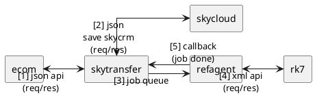

# mục tiêu
- thể hiện luồng tích hợp tổng quát ecom → rk7 qua trung gian
- ưu tiên đọc nhanh, nhìn là hiểu chiều dữ liệu
- tập trung vào quan hệ component và thứ tự trao đổi
- bỏ chi tiết cấu hình, chỉ giữ sơ đồ

# sơ đồ

