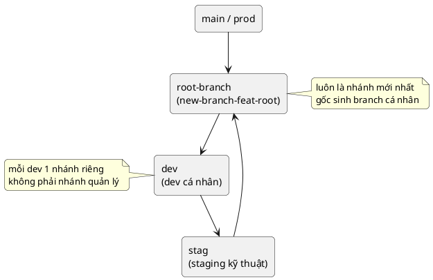

# mục tiêu
- mô tả flow nhánh git ở mức vận hành
- phân biệt nhánh gốc, nhánh cá nhân, nhánh staging
- dùng để thống nhất cách tạo, merge, quay vòng branch
- loại bỏ chi tiết kỹ thuật git không ảnh hưởng quyết định

# sơ đồ

