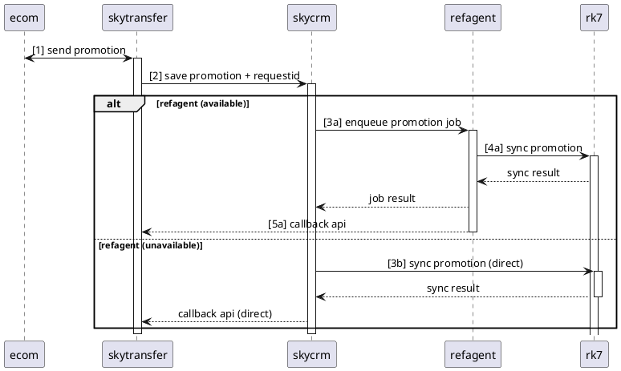

# mục tiêu
- mô tả trình tự xử lý promotion theo thời gian
- làm rõ nhánh rẽ khi có / không có refagent
- dùng để đọc nhanh luồng callback và điểm quyết định routing
- loại bỏ chi tiết triển khai không ảnh hưởng luồng

