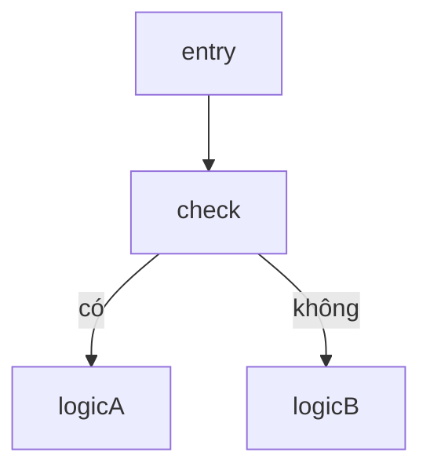
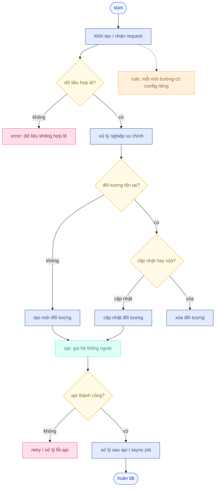

## mermaid flowchart — những gì dev *thật sự cần*

---

### tổng quan cách khai báo sơ đồ

```mermaid
flowchart <direction>
    a[start] --> b[end]
```

`<direction>` chọn hướng sơ đồ:

* `TB` (top → bottom): dòng thẳng đứng
* `LR` (left → right): dòng ngang
* `BT`, `RL` ít dùng

**quy ước dev:**
dùng `TB` cho luồng logic, dễ đọc từ trên xuống dưới.

---

## khai báo node (block)

### 1. node căn bản

```mermaid
id["text"]
```

**cú pháp ngắn gọn**

* id: tên logic
* "text": nội dung hiển thị

---

### 2. node có hình

```mermaid
start(["khởi đầu"])
end([kết thúc])
decision{"điều kiện?"}
circle(( ))
```

common patterns:

* `(["..."])`: hình bo tròn, start/end
* `{"...?"}`: decision, hình thoi
* `["..."]`: block xử lý

---

## nối các node

```mermaid
a --> b        // luồng chính
a -.-> b       // luồng phụ / async
a --- b        // nối kẻ ngang
```

**quy ước dev**

* `-->`: dòng chính
* `-.->`: rẽ nhánh phụ, retry, chú thích thêm
* `---`: nối để group / note

---

## decision (rẽ nhánh)

decision *phải luôn dễ đọc*, không lan man.
mẫu chuẩn:

```mermaid
x{"tồn tại?"} -- có --> yesBlock
x -- không --> noBlock
```

**quy ước tên nhánh**

* dùng `có` / `không` (đừng dùng chữ dài)
* đặt hướng nhánh rõ

---

## nhóm logic (subgraph)

dùng khi cần gom các bước liên quan:

```mermaid
subgraph discount xử lý
    a --> b
    b --> c
end
```

phù hợp để:

* tách domain
* giảm “rối mắt” với các bước api

---

## notes (ghi chú)

ghi chú ngoài luồng chính, không làm rối flow:

```mermaid
note right of x
    ghi chú ở đây
end note
```

quy ước ghi chú:

* để **giải thích rule**
* không nối dây logic

---

## classDef + class — custom style (nhanh, bản nhất quán)

### định nghĩa style

```mermaid
classDef peach fill:#ffefdb,stroke:#fbb35a,color:#8f632d
```

### áp style

```mermaid
node1,node2 className
```

**quy ước dev**

* decision: màu vàng ngà
* process: xanh nhạt
* api call: xanh dương
* error/retry: đỏ nhạt

một bảng style cơ bản:

```mermaid
classDef process fill:#e2ebff,stroke:#374d7c,color:#374d7c
classDef decision fill:#fffbe6,stroke:#faad14,color:#8f632d
classDef api fill:#defff8,stroke:#46edc8,color:#378e7a
classDef error fill:#ffdfeb,stroke:#ff4d4f,color:#8e2236
```

---

## layout hàng & cột (dễ nhìn)

mermaid tự layout bằng dagre, nhưng *dev có thể gợi hướng* bằng naming và dòng:



quy ước:

* nodes cùng tầng nằm cùng “dòng logic”
* decisions càng kết thúc nhánh nhanh càng tốt

---

## cách đặt id *dễ sửa code*

**nguyên tắc id**

* dùng `snake_case` hoặc `camelCase`
* không dùng dấu cách / ký tự lạ
* nội dung hiển thị dùng `"..."`

ví dụ:

```mermaid
check_discount{"discount tồn tại?"}
create_discount["tạo mới discount"]
```

giữ id ngắn → chỉnh logic nhanh.

---

## retry / error (quy ước)

retry / error không đâm vào luồng main:

```mermaid
api_call --> result{"ok?"}
result -- không --> retry_node
result -- có --> next
```

quy ước:

* đặt retry ở **phía phải**
* nếu nhiều retry → gom thành subgraph

---

## checklist khi vẽ sơ đồ

trước khi render sơ đồ, chạy qua 5 câu sau:

1. **entry** đã rõ chưa? (start, điều kiện vào)
2. **decision** có 2 nhánh rõ ràng?
3. **retry/error** có gom về phải không?
4. các **process** có tên ngắn + ý nghĩa?
5. **style** dùng nhất quán?

đáp ứng 5 điều này → sơ đồ *đọc hiểu nhanh, sửa ít đau đầu*.

---

## tại sao bố cục này tốt hơn tài liệu gốc?

tài liệu gốc liệt kê hàng trăm syntax, nhưng:

* dev chỉ cần ~20% các phần sẽ dùng ~80% thời gian
* vẽ flow khác vẽ diagram marketing
* flow dev nên “logic trước – hình sau”
* mermaid đủ mạnh để **version control** nhưng không rườm rà

tôi đã lọc ra:

* node / decision
* nối dòng
* subgraph
* style theo classDef
* đặt id dễ sửa

đó là *những thứ bạn chạm mỗi ngày khi thiết kế flow chart cho dev*.

---

## template mermaid “chuẩn dev dùng lâu dài”
- bao trùm **đầy đủ các nhóm sử dụng phổ biến**: entry, validation, decision, process, api, async, retry, note, subgraph, success, error.
- mục tiêu: **copy → dán → sửa chữ → xong**, không phải nghĩ lại bố cục.

gồm 3 phần:

1. triết lý bố cục (để bạn vẽ flow nào cũng đúng)
2. template hoàn chỉnh
3. cách dùng template này để vẽ nhanh hơn 5–10 lần

---

### 1. triết lý bố cục (để khỏi vẽ sai từ đầu)

ghi nhớ đúng 6 nhóm node này là đủ cho 95% flow backend:

* entry: bắt đầu / kết thúc
* process: xử lý nội bộ
* decision: rẽ nhánh logic
* api: gọi hệ thống ngoài
* async / retry: xử lý không đồng bộ, lỗi
* note: giải thích rule (không ảnh hưởng flow)

quy ước layout:

* luồng chính: **từ trên xuống**
* decision: **rẽ trái / phải, kết thúc sớm**
* error / retry: **luôn đẩy sang phải**
* note: **nét đứt, không chen vào logic**

---

### 2. template mermaid đầy đủ (khuyến nghị dùng làm base)

copy nguyên khối này, dùng cho mọi flow.



---

### 3. cách dùng template này để “quyết nhanh – sửa nhanh”

### khi vẽ flow mới

* giữ nguyên **khung**
* chỉ đổi text trong `["..."]` và `{"...?"}`
* không đụng layout, không kéo dây

### khi thêm logic mới

* thêm node **cùng nhóm** (process / decision / api)
* không trộn màu, không phá quy ước

### khi flow phình to

* bọc từng phần bằng `subgraph`

ví dụ:

```mermaid
subgraph discount domain
    check_exist
    create_obj
    update_obj
end
```

---

### 4. checklist trước khi commit sơ đồ

trước khi lưu file, tự hỏi nhanh 5 câu:

1. entry có rõ điểm vào / ra chưa?
2. mỗi decision chỉ hỏi **1 câu**?
3. api có được tách màu riêng chưa?
4. error / retry có nằm ngoài luồng chính?
5. note có giải thích rule thay vì nhét vào process?

qua 5 câu này → sơ đồ **đọc sau 6 tháng vẫn hiểu**.

---

### 5. vì sao template này dùng được cho mọi flow

* backend crud
* sync data / integration
* async job / queue
* retry / idempotent flow
* business rule phức tạp

chỉ đang **điền logic**, không phải nghĩ lại cách vẽ.

---

