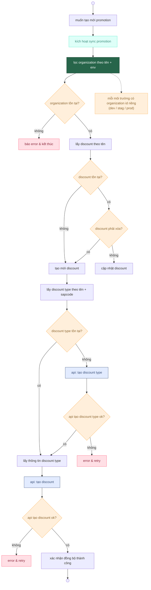

## mục tiêu

* chia sơ đồ thành **3 tầng rõ ràng**
* mỗi tầng là **1 cụm logic độc lập**
* decision chỉ rẽ nhánh *ngắn*, không kéo dây lòng thòng
* retry / error gom về cạnh phải, không chọc vào flow chính

---

## 1. bố cục đề xuất (rất quan trọng)

### tầng 1 – entry & validation (ít thay đổi)

* start
* sync
* organization check

→ tầng này gần như **ổn định lâu dài**

### tầng 2 – discount handling (hay đổi)

* discount tồn tại?
* update / delete / create

→ đây là nơi bạn sửa nhiều nhất → cần gọn, phẳng

### tầng 3 – external api & sync result (hay fail)

* discount type
* api calls
* retry / success

→ gom api sang **1 cột riêng**

---

## 2. code mermaid bố cục “sống khỏe” (khuyến nghị dùng)

bạn có thể copy nguyên khối này làm **template chuẩn**.

---

## 3. vì sao bố cục này sửa rất nhanh

* thêm rule mới cho discount
  → chỉ đụng **tầng 2**, không ảnh hưởng api
* đổi logic discount type
  → chỉ đụng **tầng 3**
* thêm env / org logic
  → chỉ đụng **tầng 1**
* retry / error
  → luôn nằm **bên phải**, không phá flow chính

não dev đọc theo chiều:

> vào → kiểm tra → xử lý → gọi api → kết quả

không zigzag, không xoắn dây.

---

## 4. nguyên tắc dùng lâu (rất đáng nhớ)

* mỗi decision **chỉ hỏi 1 câu**
* mỗi block **chỉ làm 1 việc**
* api luôn có prefix `api:`
* error luôn màu đỏ, nằm ngoài luồng chính

làm đúng 4 điều này, sơ đồ của bạn sẽ **không bao giờ nát**, kể cả sau 20 lần sửa.

---

nếu bạn muốn bước tiếp:

* tôi có thể **tách sơ đồ này thành 3 file** (entry / domain / integration)
* hoặc viết **version “async + retry queue”** cho skytransfer

đây đã là level “diagram dùng như code”, không phải vẽ cho có.
