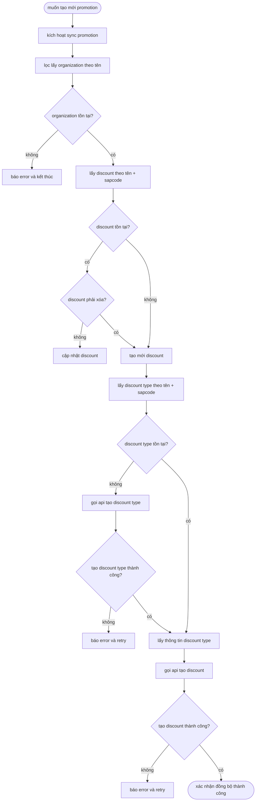
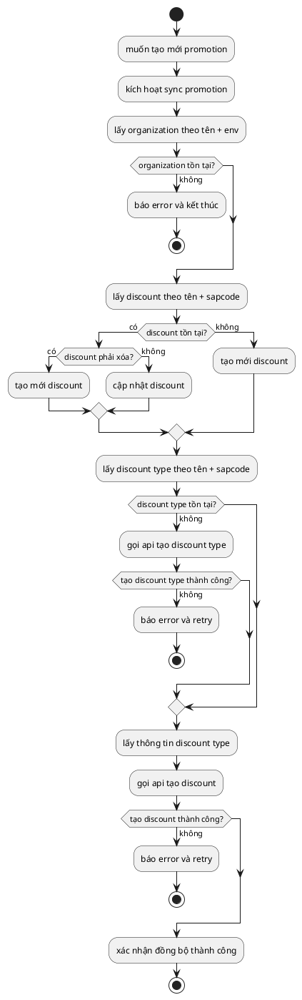

# vẽ lại logic của sơ đồ drawio theo 3 kiểu: mermaid – plantuml – d2

## tư duy chung 

- bỏ chi tiết trình bày, giữ **logic sống**
- mọi nhánh `kt` = decision
- retry / error gom gọn, không lan man

## bước thực hiện

### bước 1 – sketch

- dùng não hệ thống
- không dùng não thẩm mỹ
- càng xấu càng tốt, miễn rõ

### bước 2 – mermaid

- dùng não logic
- không căn pixel
- không chỉnh layout thủ công
- để tool lo

### bước 3 – refine

- giống clean code:

  * decision có hỏi đúng 1 câu không?
  * process có làm đúng 1 việc không?
  * error có tách khỏi happy path không?
---

## 1. mermaid – cân bằng nhất, dùng lâu không mệt

### xây dựng
phù hợp nếu bạn:

- viết markdown
- muốn để sơ đồ trong repo
- đọc nhanh, sửa nhanh



cảm giác: logic chảy mượt, nhìn là hiểu, thêm nhánh không phá layout.
### giới hạn
**mermaid không sinh ra để**
- canh pixel
- kéo giãn cho đẹp
- vẽ sơ đồ marketing
**mermaid sinh ra để**
- version control
- cập nhật nhanh
- đọc lại sau 6 tháng không chửi chính mình

=> nếu bạn cố ép nó “đẹp như figma” → bạn sẽ bực.
### chuẩn style
quy ước:

- xanh nhạt: **process**
- vàng nhạt: **decision / note**
- xanh đậm: **api call**
- đỏ nhạt: **error / retry**
---

## 2. plantuml – chuẩn chỉnh, rất hợp tài liệu kỹ thuật

### xây dựng
phù hợp nếu bạn:

- thích uml
- viết tài liệu chính thức
- team đông, cần kỷ luật



cảm giác: nghiêm túc, rõ ràng, không màu mè. đổi logic rất an tâm.

---

## 3. d2 – nhìn như sơ đồ kiến trúc, cực hợp overview

### xây dựng
phù hợp nếu bạn:

- ghét chữ nhiều
- thích sơ đồ “đọc bằng mắt”
- cần trình bày cho team nhanh

```d2
start -> sync

sync -> organization
organization -> org_ok?

org_ok? -> error: không
org_ok? -> discount: có

discount -> dis_exist?
dis_exist? -> update: tồn tại & không xóa
dis_exist? -> create_discount: không tồn tại hoặc phải xóa

create_discount -> discount_type
discount_type -> type_exist?

type_exist? -> create_type: không
create_type -> type_ok?
type_ok? -> retry: không
type_ok? -> type_info: có

type_exist? -> type_info: có
type_info -> api_create_discount
api_create_discount -> success?
success? -> retry: không
success? -> done: có
```

cảm giác: cực gọn, đọc như bản đồ, rất “dev não hình ảnh”.

---

## chốt nhanh theo 80/20

- **viết doc + code repo → mermaid**
- **viết tài liệu chuẩn, lâu dài → plantuml**
- **overview hệ thống, giải thích nhanh → d2**

nếu bạn nói thêm 1 câu:

- sơ đồ này dùng cho **team nội bộ hay tài liệu khách hàng**
- đặt ở **repo hay wiki**

tôi sẽ chốt giúp bạn **1 chuẩn duy nhất + template dùng mãi về sau**, khỏi phân vân.
